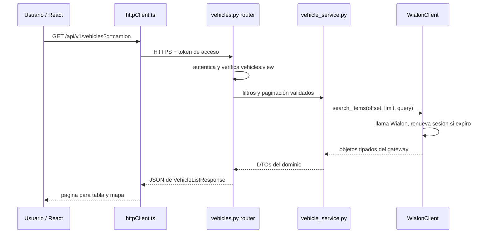

# Guía completa del repositorio

## Recorrido de una petición de flota

1. `frontend/src/features/vehicles/VehiclesPage.tsx` obtiene datos paginados mediante `vehiclesApi.ts` y TanStack Query.
2. `frontend/src/services/api/httpClient.ts` centraliza URL, cookies/CSRF, renovación y errores.
3. `backend/app/api/v1/vehicles.py` valida entrada y permiso antes de llamar al servicio.
4. `backend/app/services/vehicle_service.py` aplica búsqueda, filtro, orden y paginación; trabaja contra el protocolo `VehicleGateway`.
5. `backend/app/gateways/wialon/client.py` traduce las operaciones propias a servicios Wialon, gestiona sesión, errores, reintentos seguros de lectura y caché breve.
6. `backend/app/gateways/wialon/dto.py` y `backend/app/mappers/vehicle_mapper.py` validan y convierten los datos externos a DTOs propios.
7. La respuesta regresa por schemas Pydantic y React actualiza lista/mapa.

### La misma petición, explicada sin jerga

Cuando el usuario abre Vehículos, el navegador no conoce Wialon ni sus códigos. React pide una página de resultados al backend. El router de FastAPI recibe la URL y comprueba identidad y permiso; el servicio decide qué consulta hacer; el gateway traduce esa decisión al protocolo de Wialon; el mapper convierte la respuesta externa a campos que la UI entiende. La respuesta vuelve como JSON propio de la aplicación.

API REST significa que la interfaz solicita recursos mediante URLs y métodos HTTP: GET consulta, POST crea, PATCH modifica parcialmente y DELETE elimina. Los endpoints de producto están bajo `/api/v1`; salud y versión del despliegue están en la raíz.

### Qué hace cada capa y por qué existe

| Parte | Qué es / por qué existe | Código real y relación con otras capas |
|---|---|---|
| Router | Adaptador HTTP: sabe de URL, método, estado HTTP, autenticación y permiso. No debería contener toda la regla del negocio. | `backend/app/api/v1/vehicles.py`, `drivers.py`, `passengers.py`, `auth.py`. Los routers llaman servicios y devuelven schemas. `api_router.py` los agrupa bajo `/api/v1`. |
| Servicio / caso de uso | Función que coordina una tarea del producto y aplica reglas: listar, validar, combinar o rechazar. | `vehicle_service.py`, `people_service.py`, `auth_service.py`, `history_service.py`. Recibe gateways o repositorios por argumento; así puede probarse sin red ni DB real. |
| Gateway / Adapter | Frontera que traduce conceptos propios a la API de un proveedor. Adapter significa adaptador; gateway significa puerta de acceso. | `backend/app/gateways/wialon/client.py`: HTTP, servicio Wialon, SID, cache, errores y operaciones de unidad/personas. Los servicios consumen Protocols en vez de depender del cliente concreto. |
| DTO | Objeto de transferencia: forma explícita de transportar datos dentro de la app. Evita propagar un JSON externo arbitrario. | `backend/app/dto/vehicle.py`, `people.py`, `history.py`. Servicios y mappers los usan para definir la forma del dominio. |
| Mapper | Conversor entre el modelo que entrega un proveedor y el modelo que consume el producto. | `backend/app/mappers/vehicle_mapper.py`, `people_mapper.py`, `history_mapper.py`. Normaliza coordenadas, estado, fechas y campos. |
| Schema | Contrato de entrada/salida HTTP. Valida lo que el cliente puede enviar y documenta lo que recibe. | `backend/app/schemas/`. Pydantic valida solicitudes/respuestas de routers; un schema no es automáticamente una tabla de base de datos. |
| Modelo | Representación de una tabla SQL y sus relaciones. | `backend/app/models/`: User, Role, Permission, RefreshToken, AuditLog y LoginRateLimit. Vehículos, viajes y pasajeros no se guardan aquí: Wialon sigue siendo la fuente. |
| Repository | Objeto/funciones que concentran consultas a una fuente persistente. Esconde detalles de SQLAlchemy al caso de uso. | `backend/app/repositories/user_repository.py`, `audit_repository.py`, etc. Lo usa la capa de servicios para DB local. |
| Inyección de dependencias | Entrega una dependencia desde fuera de la función en vez de construirla dentro. FastAPI `Depends` resuelve sesiones y usuario actual. | En `api/v1/vehicles.py`, `get_wialon_gateway` entrega cliente; las pruebas pueden reemplazar la dependencia. |
| Frontend feature API | Cliente de producto que define tipos TS, arma parámetros y llama el cliente HTTP común. | `frontend/src/features/vehicles/vehiclesApi.ts` llama `httpClient.ts`; `VehiclesPage.tsx` usa la API y TanStack Query. |

SOLID explicado con ejemplos: responsabilidad única (router interpreta HTTP; servicio aplica reglas); inversión de dependencias (servicio recibe `VehicleGateway` Protocol); segregación de interfaces (cada dominio declara solo operaciones que consume). Los doubles de tests cumplen esos Protocols. No hay selección real de una Strategy/Factory en runtime; la integración activa es un gateway Wialon único. No presentes un fake como si fuera una fábrica.

### Ejemplo real: convertir una unidad de Wialon

`WialonClient.search_items` obtiene unidades de Wialon. `WialonUnit` en `backend/app/gateways/wialon/dto.py` representa el resultado ya leído. `map_vehicle` en `vehicle_mapper.py` construye `VehicleDTO` con latitud, longitud, rumbo, última comunicación y campos personalizados.

El mapper descarta coordenadas fuera de rangos válidos; marca `no_signal` cuando no hay coordenadas válidas, la marca temporal falta/es futura o supera `WIALON_NO_SIGNAL_AFTER_SECONDS`; si la posición está fresca, `motion_status` marca moving cuando la velocidad supera 3 km/h y stopped en el resto. Así la interfaz pinta una etiqueta propia sin conocer los flags de Wialon.

### Ejemplo delicado: editar un pasajero sin borrar campos

En Wialon, omitir ciertos valores de una actualización puede borrar información. Por eso `people_service.update_driver` y la ruta equivalente para pasajero vuelven a leer el objeto antes del PATCH. Copian los campos actuales, mezclan solo cambios pedidos y aplican eliminaciones explícitas. Si Wialon no devolvió campos que se necesitan para preservar el estado, el servicio lanza `UnsafePartialUpdateError` y no escribe.

Tests a estudiar: `backend/tests/unit/test_people_service.py`, especialmente `test_driver_custom_field_patch_merges_without_deleting_unmentioned_fields`, `test_passenger_custom_field_remove_is_explicit_and_retains_other_fields` y los casos `fails_closed`. Son pruebas con gateway falso: prueban el algoritmo, no demuestran persistencia real en Wialon.

### React: del router a la pantalla

`frontend/src/app/router/AppRouter.tsx` define rutas, carga algunas vistas de forma diferida y las envuelve en guards. `RequireAuth` exige sesión; `RequirePermission` oculta/bloquea una pantalla si falta permiso. Esto mejora la navegación, pero la seguridad no depende del frontend: cada endpoint vuelve a exigir autenticación y permiso en backend.

Una feature normalmente separa vista y llamadas: `VehiclesPage.tsx` muestra filtros, carga, tabla/mapa; `vehiclesApi.ts` define tipos y funciones HTTP; `httpClient.ts` define origen, credenciales, refresh y errores; `AppProviders.tsx` configura TanStack Query. TanStack Query cachea respuestas remotas y vuelve a pedirlas según las reglas de cada pantalla. React mantiene estado visual y responde al resultado.

### Identidad, datos SQL y migraciones

`backend/app/core/config.py` carga settings desde variables de entorno. `db/session.py` crea el engine y provee una sesión por petición. SQLAlchemy mapea usuarios, roles/permisos, refresh tokens, auditoría y rate limits; `alembic/` contiene cambios versionados de esquema. `db/seed.py` crea/actualiza catálogo de permisos, roles y Admin inicial de forma idempotente con settings.

El Dockerfile inicia, en este orden, `alembic upgrade head`, `python -m app.db.seed` y Uvicorn. Una migración es una instrucción versionada para mover el esquema desde su estado anterior. Seed significa cargar datos iniciales requeridos para el servicio. En desarrollo: crear virtualenv, instalar `requirements.txt`, preparar `.env` local ignorado por Git, ejecutar Alembic, seed y Uvicorn. No copies producción `.env` a documentación ni tests.

Los tokens de refresh se guardan como hashes en SQL; access token JWT corto va en memoria del frontend; refresh y CSRF usan cookies seguras según configuración. La DB es para cuentas locales, no una copia durable de Wialon.

### Errores y seguridad en el camino

`main.py` monta CORS con una lista explícita, cabeceras de seguridad y manejadores de error que responden Problem Details. El problema se convierte luego a un mensaje seguro en `frontend/src/services/api/apiError.ts`. No devuelvas traza, token, SID Wialon ni password al cliente. `logging_config.py` configura formato JSON y los mensajes deben usar identificadores no secretos.

`auth.py` autentica y gestiona endpoints; `core/dependencies.py` resuelve usuario, permisos y CSRF; `core/security.py` hashea/verifica Argon2 y crea/verifica JWT. `middleware/security_headers.py` pone CSP y otras cabeceras. `services/csv_service.py` neutraliza celdas para evitar que hojas de cálculo ejecuten fórmulas. React escapa texto por defecto; no usar HTML crudo sin una necesidad y sanitización justificadas.

### Pruebas, ejecución y límites de evidencia

- Backend: desde `backend`, `.venv/Scripts/python.exe -m pytest tests -q` en Windows o `python -m pytest tests -q` en entorno activado. Hay tests unitarios de servicios/mappers/gateway y tests HTTP con TestClient. Los gateways falsos no conectan a Wialon real.
- Frontend: desde `frontend`, `npm test`, `npm run typecheck`, `npm run build`. Vitest/Testing Library prueban comportamientos de componentes y requests simulados.
- Docker Compose: GitHub Actions valida y arranca el conjunto; Docker CLI no estuvo disponible en la máquina de la auditoría.
- Último resultado confirmado: backend 138 tests; frontend 69 tests; CI de `381d619` con jobs backend, frontend y docker-compose en success.
- Comprobación de despliegue: Render `/version` devolvió SHA completo de `main`; Vercel/Render y proxy health 200; `/auth/me` sin sesión dio 401 esperado. No se hizo login de la cuenta real, no se leyeron secretos y no se escribieron datos Wialon.

### Recorrido recomendado para entenderlo

1. Lee el requisito RF-10 en `docs/prueba_tecnica.md`.
2. Abre `VehiclesPage.tsx` y busca la función que carga una página.
3. Sigue a `vehiclesApi.ts`, luego `httpClient.ts`.
4. Abre el endpoint GET de `api/v1/vehicles.py`; identifica dependencia y schema.
5. Sigue la llamada a `vehicle_service.list_vehicles` y su `VehicleGateway` Protocol.
6. Busca la implementación en `WialonClient.search_items` y la conversión en `map_vehicle`.
7. Abre un unit test para entender qué se simula.
8. Explícalo con tus palabras: "la UI no habla con Wialon; la API valida acceso; el servicio coordina; el gateway traduce; el mapper convierte; el schema define la respuesta".

## Carpetas

| Ruta | Propósito |
| --- | --- |
| `backend/app/api/v1/` | Presentación HTTP, permisos y contratos de endpoint. |
| `backend/app/services/` | Casos de uso y reglas del dominio. |
| `backend/app/repositories/` | Persistencia local SQLAlchemy. |
| `backend/app/models/` | Tablas y relaciones. |
| `backend/app/gateways/wialon/` | Adaptador, sesión, DTOs y errores del proveedor. |
| `backend/app/mappers/`, `backend/app/dto/`, `backend/app/schemas/` | Transformación y contratos propios. |
| `backend/alembic/` | Historial de esquema SQL. |
| `backend/tests/` | Unitarias e integración HTTP con dobles/mock del proveedor. |
| `frontend/src/features/` | Vistas organizadas por dominio funcional. |
| `frontend/src/services/api/` | Transporte API y normalización de fallos. |
| `frontend/src/components/` | Controles visuales/feedback compartidos. |
| `frontend/tests/` | Pruebas de router, auth y vistas. |
| `docs/` | Requisitos, decisiones, evidencia y defensa. |

## Persistencia local vs. remota

La aplicación guarda cuentas locales, roles/permisos, refresh token hasheados, auditoría y contadores de rate limit. Los vehículos, mensajes, conductores y pasajeros se consultan desde Wialon; no se replican como fuente de verdad en PostgreSQL. Las lecturas tienen caché breve en memoria; escrituras remotas no se reintentan automáticamente por ambigüedad del resultado.

## Seguridad y roles

El seed define permisos granulares y tres roles (`admin`, `operator`, `viewer`). Las rutas de frontend ajustan navegación, mientras que las dependencias de backend autorizan cada endpoint. Admin gestiona cuentas y auditoría; operator ejecuta operaciones permitidas; viewer tiene lectura. Pruebas relevantes: `backend/tests/integration/test_people_rbac.py`, `test_exports_rbac.py`, `test_dashboard_rbac.py`, `test_audit_rbac.py`.

## Pruebas documentadas

- Backend cierre: 138 tests passed; la cobertura no se recalculo en esa actualizacion.
- Frontend: 15 archivos, 69 tests passed; typecheck y build correctos.
- CI declara `pip-audit`, `npm audit`, pruebas, build y validación/arranque Docker Compose.
- No hay linter configurado en scripts de frontend; la revisión con lector de pantalla requiere una persona.
